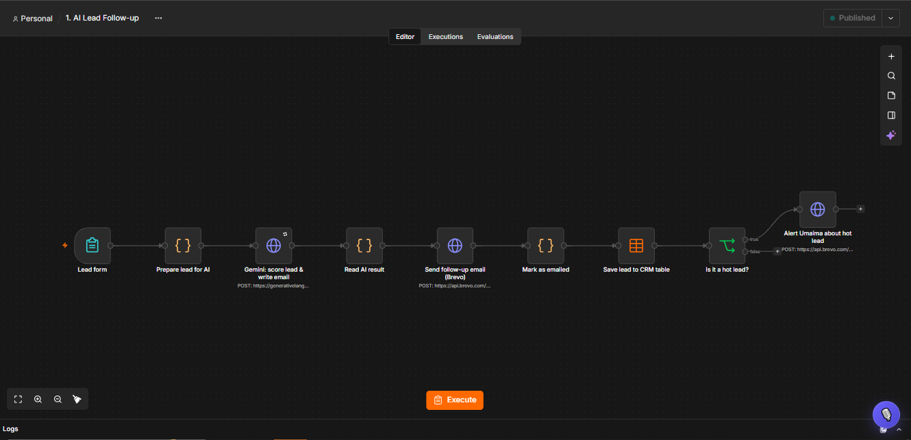
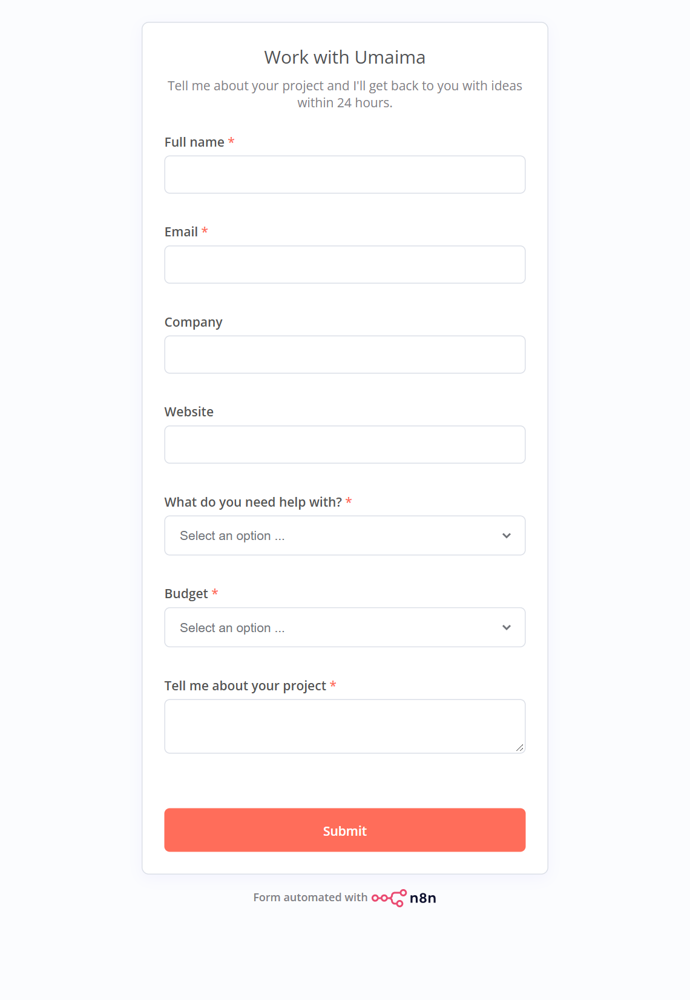
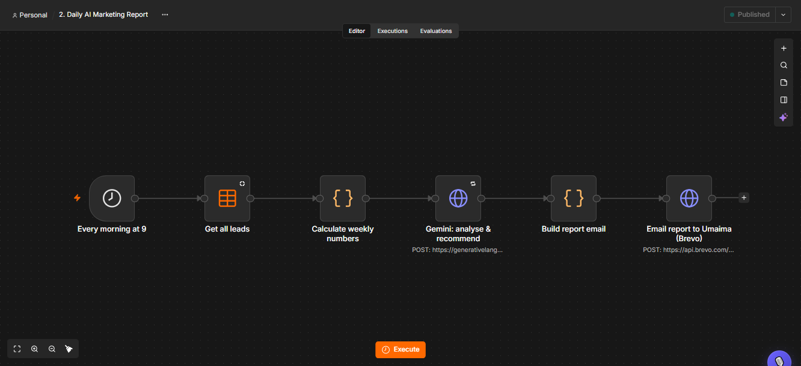
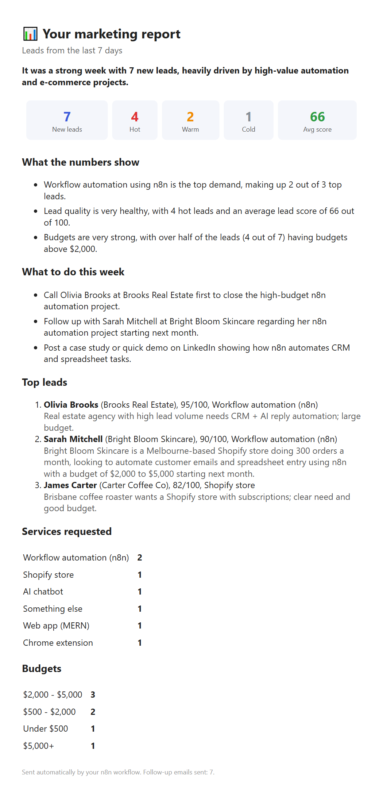

# AI Marketing Automation with n8n

Two n8n workflows that do a small business's lead handling with AI. Every new enquiry gets scored and answered within seconds, and the owner gets a daily report on what is selling and who to call first.

Built with **n8n**, **Google Gemini** (LLM with structured JSON output), **Brevo** (transactional email API) and **n8n Data Tables** (as a simple CRM).

---

## Workflow 1: AI Lead Follow-up

**Trigger:** someone fills in the contact form (n8n Form Trigger).

1. **Prepare lead for AI** (Code): cleans the form answers and builds the prompt.
2. **Gemini: score lead & write email** (HTTP Request): Gemini returns strict JSON through a response schema:
   - `score` from 0 to 100 and `temperature` (hot / warm / cold)
   - `summary`: one line for the business owner
   - `email_subject` + `email_body`: a personal follow-up that mentions the lead's project and suggests a next step
3. **Send follow-up email** (Brevo API): the lead gets a reply straight away.
4. **Save lead to CRM table** (Data Table): every lead is stored with its score and AI summary.
5. **Is it a hot lead?** (IF): when it is, the owner gets an instant alert email with the details.

| The form | Example AI result (saved in the CRM table) |
|---|---|
|  | **Lead:** Shopify skincare store, 300 orders/month, wants to automate customer emails, budget $2,000 to $5,000  **Score:** 90 · **hot**  **Summary:** Melbourne-based Shopify store looking to automate customer support emails and order tracking using n8n.  **Email sent:** "Hi Sarah, it sounds like your team is spending too much time on repetitive tasks… we can set up an n8n workflow that logs orders into your spreadsheet and uses AI to draft instant replies… Do you have 15 minutes for a quick call this Tuesday or Wednesday?" |

## Workflow 2: Daily AI Marketing Report

**Trigger:** every morning at 9:00 (Schedule Trigger).

1. **Get all leads** (Data Table).
2. **Calculate weekly numbers** (Code): leads in the last 7 days, hot/warm/cold split, average score, most requested services, budgets, top 3 leads.
3. **Gemini: analyse & recommend** (HTTP Request): returns a headline, 3 insights and 3 concrete actions for the week as JSON.
4. **Build report email** (Code): turns it into a clean HTML email with KPI tiles.
5. **Email report** (Brevo API).

---

## What this shows

- **AI agents in workflows:** LLM calls with a JSON response schema, so the output is always machine-readable (no fragile text parsing).
- **APIs, webhooks and integrations:** form trigger, REST APIs with header-auth credentials, transactional email.
- **Data handling:** a CRM table, aggregation in JavaScript, HTML reporting.
- **Reliability:** retries on the AI step, credentials stored in n8n (never in the workflow files), timezone-aware scheduling.

## Run it yourself

1. Install n8n: `npm install -g n8n`, then `n8n start` and open http://localhost:5678.
2. Create two credentials of type **Header Auth**:
   - `Gemini API key`: header name `x-goog-api-key`, value = a free key from [Google AI Studio](https://aistudio.google.com/apikey)
   - `Brevo API key`: header name `api-key`, value = a key from Brevo → Settings → SMTP & API
3. Create a Data Table called `leads` with the columns used in `sample-data/sample-leads.json`.
4. Import `workflows/1-ai-lead-follow-up.json` and `workflows/2-daily-ai-marketing-report.json` (Workflows → Import from file). Then select your credentials and your `leads` table in the nodes, change the sender/owner email, and publish.

`build_wf1.py` and `build_wf2.py` generate the workflow files and push them to n8n through its public API.

> The leads in `sample-data/` are made-up examples used for the demo report.

---

## About me

**Syeda Umaima**, software engineer building AI automations, Shopify stores, Chrome extensions and MERN web apps.

- Email: imumaimabukhari@gmail.com
- Fiverr: [fiverr.com/umaima886](https://www.fiverr.com/umaima886)
- GitHub: [github.com/imumaimabukhari-123](https://github.com/imumaimabukhari-123)
- LinkedIn: [linkedin.com/in/umaima-bukhari-1a4764372](https://www.linkedin.com/in/umaima-bukhari-1a4764372/)
